# 🏥 Hospital Token Management System — Minimum Viable Product (MVP) Specification

## 1. Executive Summary

The **Hospital Token Management System** is a real-time, digital OPD queue orchestration platform designed to eliminate chaotic physical waiting lines, minimize patient anxiety, and streamline outpatient consultation workflows across hospital departments.

Built with **React 18**, **Vite**, **Tailwind CSS**, and **Supabase (PostgreSQL, GoTrue Auth, and Realtime WebSockets)**, the application delivers four dedicated role-based portals with end-to-end security, instant WebSocket updates, and database-level business logic integrity.

---

## 2. Core Problem & Value Proposition

| Traditional Hospital Challenges | Hospital Token System MVP Solution |
| :--- | :--- |
| **Crowded OPD Waiting Areas**: Patients cluster outside doctor consultation rooms without knowing their queue position. | **Live Digital Queue Tracker**: Patients view real-time countdown of patients ahead and estimated wait minutes from their phones or lobby screens. |
| **No-Shows & Queue Bottlenecks**: Absent patients stall consultation order. | **Instant Queue State Machine**: Doctors can mark no-shows as *Skipped* with one click and immediately call the next patient. Skipped patients can be re-queued without restarting from token #1. |
| **Emergency Case Handling**: Critical patients require immediate consultation overriding ordinary sequence. | **Emergency Priority Preemption**: Priority tokens automatically leapfrog standard tokens at the top of the queue. |
| **Administrative Blind Spots**: Hospital management lacks real-time insight into OPD volume, doctor workload, and patient throughput. | **Central Administrator Dashboard**: Real-time KPI counters, doctor/staff directory management, global patient registry, and queue audit logs. |

---

## 3. Technology Stack

- **Frontend**: React 18, React Router v6, Tailwind CSS v4, Lucide Icons
- **Build Tool**: Vite 5 (Sub-second HMR, optimized production tree-shaking)
- **Backend & Database**: Supabase (PostgreSQL 15)
- **Authentication**: Supabase GoTrue Auth with encrypted bcrypt password storage and `auth.identities` synchronization
- **Realtime Layer**: Supabase Realtime Engine via PostgreSQL Replication publications (`tokens`, `doctors`)
- **Hosting & Infrastructure**: Vercel (Edge CDN, SPA Rewrites, Automated Git Deployments)
- **Testing**: Node.js Native Test Runner (`node:test`, `node:assert`) with zero bloated test dependencies

---

## 4. Role-Based Architecture & Features

```mermaid
graph TD
    A[Hospital Token System] --> B[👑 Administrator]
    A --> C[🩺 Doctor]
    A --> D[🏥 Receptionist]
    A --> E[👤 Patient]

    B --> B1[Real-time Hospital KPIs]
    B --> B2[Doctor CRUD & Availability]
    B --> B3[Receptionist Staff Provisioning]
    B --> B4[Global Patient Directory & History]
    B --> B5[Token Queue Override & Audit]

    C --> C1[Call Next Patient]
    C --> C2[Start Consultation]
    C --> C3[Complete / Skip / No-show]
    C --> C4[Desk Availability Toggle]

    D --> D1[Walk-in Patient Token Issue]
    D --> D2[Emergency Priority Flag]
    D --> D3[Re-queue Skipped Tokens]
    D --> D4[Doctor Availability Monitor]

    E --> E1[Self-Service Token Booking]
    E --> E2[Live Patients Ahead Counter]
    E --> E3[Estimated Consultation Countdown]
```



### 4.1. 👑 Administrator Dashboard (`/admin`)
- **Live KPI Metrics**: Real-time counter cards displaying:
  - Total tokens generated today
  - Active waiting queue
  - Completed consultations
  - Emergency/priority cases
  - On-duty and available doctors
- **Doctor Management (CRUD)**:
  - Create doctor login accounts with automated Supabase GoTrue provisioning.
  - Assign specialty departments (General Medicine, Cardiology, Pediatrics, Orthopedics, Dermatology, ENT, Gynecology).
  - Configure target average consultation durations (in minutes).
  - Real-time availability and account active/inactive switches.
  - Safe deletion: Database prevents deletion of doctors with historical token records.
- **Staff / Receptionist Management (CRUD)**:
  - Provision reception staff with instant credentials.
  - Toggle staff status or update profile information.
- **Global Patient Directory**:
  - Filter and search registered patients by full name, phone number, or ID.
  - Consultation history modal displaying past visits, assigned doctors, dates, and token outcomes.
- **Hospital-Wide Token Queue Monitor**:
  - Filter all tokens by date, doctor, or status (`waiting`, `called`, `in_consultation`, `completed`, `skipped`, `cancelled`).
  - Administrative override actions: cancel or requeue tokens on demand.

### 4.2. 🩺 Doctor Consultation Desk (`/doctor`)
- **Queue Control Panel**:
  - **Call Next Patient**: Summons the highest-priority patient in queue.
  - **Start Consultation**: Transitions patient state to active consultation.
  - **Complete**: Finalizes consultation and automatically records time for moving-average calculation.
  - **Skip**: Flags no-show patients, immediately unblocking the consultation room.
- **Live Waiting List**: Real-time list of waiting patients ordered by emergency status and token number.
- **Availability Toggle**: Switch status between *Available* and *On Break* with instant reflection across the hospital.

### 4.3. 🏥 Receptionist Desk (`/reception`)
- **Walk-in Patient Token Creation**:
  - Rapid token creation form with patient name, 10-digit phone, and doctor selection.
  - **Emergency Priority Checkbox**: Immediate escalation for urgent patients.
- **Queue Management**:
  - Re-queue patients who missed their initial call.
  - Cancel tokens if a patient leaves before consultation.
- **Doctor Directory View**:
  - Live overview of all hospital doctors, consultation rooms, and availability status.

### 4.4. 👤 Patient Self-Service Portal (`/patient`)
- **Online Token Booking**: Select preferred doctor/department and book an instant queue token.
- **Real-Time Queue Tracker**:
  - Displays user's assigned token number (e.g., `#04`).
  - Live indicator of token currently inside the doctor's room.
  - Number of patients ahead in the queue.
  - Calculated estimated wait time in minutes.
- **Emergency Case Badge**: Clear visual confirmation if token is flagged as urgent priority.

---

## 5. Security & Engineering Standards

1. **Zero Secret Leaks**:
   - Strictly no hardcoded API keys or service-role secrets in code or repository.
   - Authentication relies exclusively on the public `anon` key, with database-level security enforcing access control.
   - `.env` is strictly ignored by `.gitignore`.

2. **Row-Level Security (RLS) & Stored Procedures**:
   - Client applications never write directly to sensitive database tables.
   - All state mutations are performed through PostgreSQL `SECURITY DEFINER` functions (`create_token`, `call_next`, `complete_token`, `admin_create_doctor`, etc.).

3. **Strict Validation Pipeline**:
   - **Phone Numbers**: 10-digit Indian mobile format (`/^[6-9]\d{9}$/`) validated on the client and enforced by PostgreSQL database triggers.
   - **Passwords**: Minimum 6-character length constraint validated on client forms and backend RPCs.
   - **Password Visibility Toggles**: Interactive, accessible eye icons on all password fields.

4. **Dynamic Wait Time Estimation Algorithm**:
   - When a doctor has completed $\ge 5$ consultations today, the system computes the actual rolling average duration of their completed consultations.
   - For fewer than 5 consultations, it falls back to the doctor's configured baseline duration (default: 10 minutes).
   - $\text{Estimated Wait} = \text{Patients Ahead} \times \text{Average Consultation Minutes}$.

---

## 6. Database Architecture

### Enums & Custom Types
- `user_role`: `'patient'`, `'receptionist'`, `'doctor'`, `'admin'`
- `token_status`: `'waiting'`, `'called'`, `'in_consultation'`, `'completed'`, `'skipped'`, `'cancelled'`

### Key Tables
- `auth.users`: Supabase managed authentication accounts.
- `public.profiles`: User details, phone numbers, active status, and application role.
- `public.departments`: Hospital medical departments.
- `public.doctors`: Doctor profiles linked to departments, availability flags, and baseline consultation duration.
- `public.tokens`: Daily queue records linked to doctor, date, sequential token number, priority flag, and status timestamps (`called_at`, `started_at`, `completed_at`).
- `public.token_details`: Patient identification metadata isolated from public queue broadcasting for privacy compliance.
- `public.doctor_day_counters`: Atomic per-doctor daily token increment counters preventing race conditions.

---

## 7. Automated Verification Suite

The MVP includes a 20-test automated test suite:

```bash
node --env-file=.env --test test/validation.test.js test/admin_crud.test.js test/tokens.test.js
```

### Verification Results
```text
✔ Admin Doctor & Staff Account Validation (3 tests passed)
✔ Patient Directory & Token Search/Filter Logic (2 tests passed)
✔ Token Queue Ordering & Business Logic (5 tests passed)
✔ Role Home Redirections (1 test passed)
✔ Patient Phone Number Validation (6 tests passed)
✔ Minimum Password Length Validation (3 tests passed)

ℹ tests 20
ℹ suites 6
ℹ pass 20
ℹ fail 0
```

---

## 8. Deployment Specifications

- **Hosting Platform**: Vercel
- **Build Configuration**:
  - Framework: Vite
  - Build Command: `vite build`
  - Output Directory: `dist`
  - SPA Rewrites: `/(.*)` $\rightarrow$ `/index.html`
- **Environment Variables**:
  - `VITE_SUPABASE_URL`: Supabase project URL
  - `VITE_SUPABASE_ANON_KEY`: Supabase anon public key

---

## 9. Post-MVP Roadmap (Future Enhancements)

- [ ] **SMS / WhatsApp Gateway**: Automated SMS alert when patient is 2 tokens away from consultation.
- [ ] **Lobby TV Display Mode**: Full-screen kiosk display mode with audible audio chimes ("Token 05, please proceed to Room 2").
- [ ] **Multi-Facility / Multi-Branch Support**: Unified management for hospital chains across different locations.
- [ ] **Doctor Prescription & Notes**: Digital prescription attachment to completed consultation records.
- [ ] **Analytics & Export**: PDF/Excel export for daily OPD metrics, wait-time bottlenecks, and doctor utilization rates.
